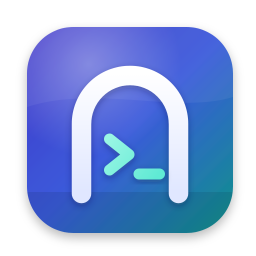

<p align="center"></p>

<h1 align="center">Gatehouse</h1>

<p align="center"><b>给 Claude 用的 SSH 客户端兼安全网关</b><br>
让 Claude 在你的服务器上工作——但永远不把钥匙交给它。</p>

---

Gatehouse 是一款 macOS 应用，主要有两个用途：

1. **好用的 SSH 客户端**：主机管理、多标签终端、SFTP 文件管理、端口转发、密钥管理、代码片段。
2. **AI 安全网关**：Claude（Claude Code、Claude Desktop 或任何 MCP 客户端）**只能**通过 Gatehouse 提供的 MCP 工具访问你的服务器。
   - Claude 看到的只有你取的**别名**，看不到 IP、主机名、用户名和密钥。
   - 每个请求都会先按你的策略分类：有风险的操作要你批准，危险命令直接拦截。
   - 所有输出先脱敏，再交给 Claude。
   - 每一笔请求都写进防篡改的审计日志。

## 功能一览

| 类别 | 功能 |
| --- | --- |
| 主机 | 网格/列表视图、分组与标签、收藏、颜色标记、一键从 `~/.ssh/config` 导入（支持 Include、ProxyJump） |
| 认证 | SSH 密钥（Ed25519 / RSA / ECDSA，可生成或导入）、密码、SSH Agent（含 1Password agent）、键盘交互/两步验证 |
| 终端 | 多标签、WebGL 渲染、流量控制、终端内搜索、7 款配色、多行粘贴确认、断线重连、启动命令 |
| 文件 | SFTP 浏览、拖放上传、批量下载、在线编辑文本（⌘S 保存）、权限设置、传输队列与进度 |
| 隧道 | 本地转发 `-L`、远程转发 `-R`、SOCKS5 代理 `-D`，可开机自动启动，显示流量统计 |
| 连接 | 共享连接（类似 ControlMaster）、跳板机链、强化加密算法（可为老服务器开启旧算法）、保活 |
| 远端兼容 | 只要对方运行 SSH 服务即可连接，**不限品牌、架构或操作系统**：Linux / macOS / Windows(OpenSSH) / BSD，x86_64 / ARM，AMD（含 Ryzen AI Max 395、ROCm）、Intel（oneAPI）、NVIDIA 等各种硬件生态 |
| 加速器感知 | 命令分类器识别各家 GPU/NPU 工具：查询/监控（`nvidia-smi`、`rocm-smi`、`amd-smi`、`xrt-smi`、`xpu-smi`、`rocminfo`、`clinfo` 等）视为只读自动放行；改时钟/功耗/风扇/固件/分区等操作仍需批准 |
| 主机密钥 | 首次连接核对指纹并固定；密钥改变时强制警告；会沿用 `~/.ssh/known_hosts` 中已有的信任 |
| AI 网关 | 每台主机四种权限、人工批准（可先修改命令、可拒绝并留言、可临时授权）、紧急停用开关、速率与每日上限 |
| 脱敏 | IP / IPv6 / MAC、已保存的主机名与用户名、各类 API 令牌与私钥、自定义正则（例如病历号） |
| 审计 | SHA-256 哈希链 JSONL，可一键校验完整性，导出 CSV / JSON |
| 安全 | AES-256-GCM 加密保险库（macOS 钥匙串 + 可选主密码）、Touch ID 锁屏与批准、隐私模式（共享屏幕时模糊地址） |
| 其他 | 命令面板 ⌘K、菜单栏图标、通知、深色模式、中文 / 英文界面、加密备份与恢复 |

## 安全设计

```
Claude ──MCP(stdio)──▶ gatehouse-mcp ──私有 Unix 套接字 + 令牌──▶ Gatehouse ──SSH──▶ 你的服务器
                        （不含任何机密）                        策略 · 批准 · 脱敏 · 审计
```

- **Claude 能看到的**：主机别名、你写的主机说明、权限级别；命令输出和文件内容（脱敏后）。
- **Claude 看不到的**：IP、主机名、用户名、端口、密码、私钥、跳板机。输出中出现这些值时，会被替换成 `[host:web]`、`[user:web]`、`[ip-1]` 这样的占位符。Claude 可以在之后的命令里沿用占位符，由 Gatehouse 在执行前换回真实值。

### 每台主机四种权限

| 权限 | 行为 |
| --- | --- |
| 关闭 | 对 AI 完全隐藏 |
| 只读 | 只有确认是只读的命令会自动执行，其余一律拒绝（读取机密文件时仍会询问） |
| 询问（推荐） | 只读命令自动执行；任何会改变状态的操作都要等你批准 |
| 信任 | 自动执行，但高风险命令仍需批准 |

### 命令分类器

- 只读判断采用**白名单**：每一段管道、每个参数都要通过检查。只要出现写入重定向、命令替换、变量展开、子 shell 或后台任务，就不算只读。
- 高风险检测：涵盖 `rm -rf`、关机重启、防火墙、可能锁死 SSH 的操作、删库、`git push --force`、`curl | sh` 等三十多类。
- **始终拦截**：递归删除 `/` 或系统目录、直接写入磁盘设备、fork 炸弹。
- AI 的命令统一用 `bash -c` 执行，避免因登录 shell 不同而产生解析差异。每次都是全新的非交互 shell，不会被 alias 篡改。

### 批准

批准卡片上会显示：风险等级、需要批准的原因、AI 给出的理由（并提醒你按命令本身判断）、完整命令，以及占位符替换前后的对照。

你可以：

- 允许一次
- 先修改命令再执行
- 拒绝，或拒绝并留言给 Claude
- 在 N 分钟内临时授权（不含高风险操作）
- 把这条命令加入允许列表

高风险命令需要 Touch ID；没有 Touch ID 时，需要输入主机别名确认。超时未回应的请求一律拒绝。

### 其他保障

- 套接字放在权限为 0700 的目录中，本身权限为 0600，并且每次连接都要校验随机令牌。
- 渲染进程开启沙箱和上下文隔离，有 CSP 限制，所有 IPC 输入都经过 zod 校验。
- 发布版关闭了 Electron 的 `RunAsNode`、`NODE_OPTIONS` 和 `--inspect` 相关开关（fuses），并启用 asar 完整性校验。

> **请注意：脱敏是隐私保护，不是安全边界。** Claude 拥有 shell 权限时，可以把数据转换后再输出（例如 base64），这样任何规则都匹配不到。真正敏感的主机（例如存有病患资料的服务器）请设为“只读”或“关闭”，并在“策略 → 敏感路径”中加入相关目录。

## 安装

1. 到正式版下载页：**[Gatehouse 1.0.0 Release](https://github.com/woodyair233-oss/claude/releases/tag/gatehouse-v1.0.0)**（开发中的构建也可以在 **Actions → Gatehouse** 最新一次成功运行的 Artifacts 里找到）。
2. 下载对应的 DMG：
   - Apple 芯片（M1 及以后）：`Gatehouse-1.0.0-arm64.dmg`
   - Intel 芯片：`Gatehouse-1.0.0-x64.dmg`
   - 可选校验：和 DMG 放在同一目录下载 `SHA256SUMS.txt`，在“终端”执行 `shasum -a 256 -c SHA256SUMS.txt --ignore-missing`，显示 `OK` 即文件完整。
3. 打开 DMG，把 Gatehouse 拖进“应用程序”文件夹。
4. **首次打开**：应用没有 Apple 开发者签名（只有临时签名，ad-hoc signature），macOS 会阻止它打开。可以选择以下任一方式：
   - 在“应用程序”中按住 Control 点按 Gatehouse，选择“打开”；
   - 或者到“系统设置 → 隐私与安全性”，点“仍要打开”；
   - 或者在“终端”中执行：
     ```bash
     xattr -dr com.apple.quarantine /Applications/Gatehouse.app
     ```
5. 第一次连接局域网服务器时，macOS 会请求“本地网络”权限，请点“允许”。

需要 macOS 12 或更新版本。

## 连接 Claude

在 Gatehouse 中打开 **AI 网关 → 概览 → 配置**：

- **Claude Code**：点“添加到 Claude Code”。也可以在“终端”中执行一次下面的命令：
  ```bash
  claude mcp add --scope user gatehouse -- /Applications/Gatehouse.app/Contents/Resources/bin/gatehouse-mcp
  ```
  完成后在 Claude Code 中运行 `/mcp`，应该能看到 gatehouse 的工具。
- **Claude Desktop**：点“添加到 Claude Desktop”，再退出并重新打开 Claude Desktop。Gatehouse 会把配置写进 `claude_desktop_config.json`，并保留原文件的备份。
- **其他 MCP 客户端**（Cursor、VS Code 等）：复制页面上显示的 JSON 配置。
- 点“运行自检”可以确认桥接程序、套接字和 MCP 握手都正常。

Claude 启动 MCP 服务器时，如果 Gatehouse 没有在运行，桥接程序会自动在后台启动它。

> 小提示：Claude Code 自己也会询问是否允许使用工具。如果觉得两层询问太繁琐，可以在 Claude Code 中允许 `mcp__gatehouse__*`，把把关交给 Gatehouse。

### MCP 工具

| 工具 | 说明 |
| --- | --- |
| `list_hosts` | 列出可用主机（只含别名、说明和权限） |
| `run_command` | 在主机上执行命令（可指定 `cwd`、`timeout_seconds`、`reason`） |
| `get_host_info` | 系统、内核、负载、CPU、内存、根分区（只读） |
| `read_file` | 读取文本文件，可分页（`offset`、`max_bytes`） |
| `list_directory` | 列出目录 |
| `write_file` | 写入或追加文件（通常需要批准，批准前你会先看到内容） |
| `list_snippets` / `run_snippet` | 列出并运行你标记为“AI 可用”的代码片段 |

## 使用小贴士

- **⌘K** 打开命令面板，可以快速连接主机、跳转页面、暂停 AI。
- 侧边栏底部和菜单栏图标都有 **AI 访问开关**。关闭后，所有 AI 请求立即被拒绝，待批准的请求会取消，正在执行的命令会被终止。
- 在“主机编辑 → AI 权限”和“策略”页面都可以 **试一条命令**，马上看到这条命令会被如何分类和处理。
- 你常用、且确认安全的操作，可以做成代码片段并勾选“允许 Claude 运行”。这样 Claude 就能直接执行这条命令（而且只能是这条），不用每次问你。
- 自定义脱敏规则示例：用 `MRN\d{6,10}` 替换成 `[MRN]`，可以隐藏病历号。
- **设置 → 数据**：可以导出加密备份（包含密码和私钥），换电脑时直接恢复。

## 常见问题

**更新应用后，为什么 macOS 又询问是否允许访问钥匙串？**
因为应用是临时签名，每个版本的签名都不同，钥匙串会把它当成新的应用。点“始终允许”即可。如果设置了主密码，也可以用主密码解锁。

**数据存放在哪里？**
`~/Library/Application Support/Gatehouse`，包含：

- `gatehouse.json`：主机与设置
- `vault.json`：加密的机密信息
- `audit/`：审计日志

**如何完全移除？**

1. 删除应用和上面的数据文件夹。
2. 在 Claude Code 中执行下面的命令，并删除 Claude Desktop 配置中的 `gatehouse` 项：
   ```bash
   claude mcp remove gatehouse -s user
   ```

**Claude 说某个命令“被拒绝”，但我认为它是安全的？**
有两种处理方式：

- 在批准卡片上选择“始终允许”；
- 或者在“主机编辑 → AI 权限 → 始终允许”中加入这条命令（可以用 `*` 通配）。

如果是某个程序你认为整体只读，可以加到“策略 → 额外的只读命令”。

## 从源码构建

需要 Node.js 22 和 Go 1.22 以上的版本。

```bash
cd Gatehouse
npm ci
npm run build          # 构建 Go 桥接程序、主进程和界面
npm start              # 以开发模式启动
npm run dist:mac       # 在 macOS 上打包 DMG（临时签名）
```

测试：

```bash
npm test                         # 单元测试（命令分类器、脱敏）
sudo npm run test:integration    # 集成测试：本机 OpenSSH + MCP 桥接程序（需 root）
xvfb-run -a node tests/e2e/ui.cjs out/  # 端到端测试：真实 Electron 界面 + 截图
```

## 架构

```
bridge/              Go 写的 stdio ↔ 套接字桥接程序（gatehouse-mcp）
src/shared/          命令解析与分类、策略、脱敏、类型（主进程与界面共用）
src/main/            Electron 主进程
  ssh/               连接池、命令执行、终端、SFTP、端口转发、ssh_config 导入
  gateway/           MCP 工具、批准、审计、套接字服务器、Claude 配置与自检
  vault.ts store.ts  加密保险库与数据存储
src/renderer/        React 界面
tests/               单元、集成（真实 sshd）、端到端测试
```

## 已知限制

- 应用使用临时签名，没有经过 Apple 公证（notarization），首次打开需要手动允许。
- Claude 执行的命令运行在非交互 shell 中，没有 TTY。需要输入密码的 `sudo` 无法使用，请为需要的操作配置免密 sudo。
- 命令分类器尽量保守，但不可能涵盖所有程序的所有参数。人工批准才是最终防线，敏感主机请使用“只读”或“询问”。
- 远程命令超时后，会先发送 INT / TERM / KILL 信号，再终止整个进程组。极少数不支持信号的服务器，只能关闭通道。
